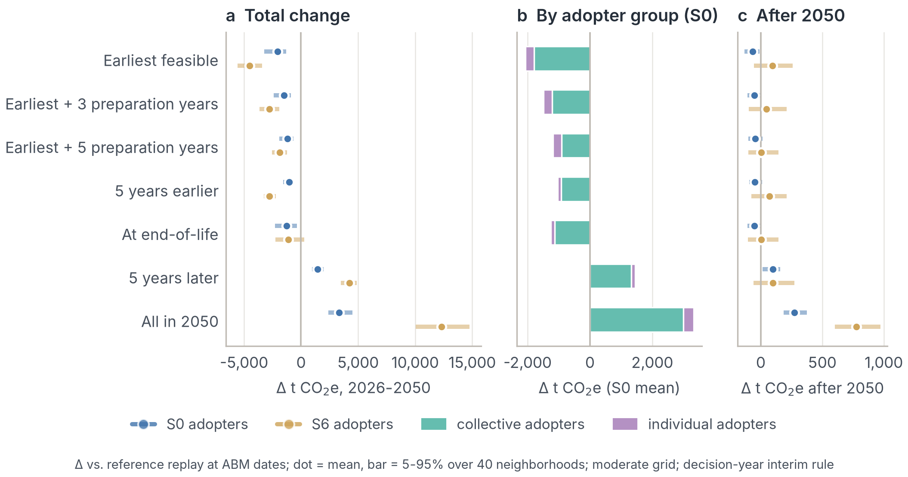

# How does the timing of collective heating decisions change emissions?

**Xinyi Mu**

Two neighborhoods can install the same heating systems by 2050 and still produce different cumulative emissions. To measure the effect of timing, I coupled an agent-based model of apartment owners and homeowners’ associations (*verenigingen van eigenaars*, VvEs) to a time-explicit greenhouse gas life-cycle assessment. The model simulates how a proposal reaches a vote, when a building converts, and which equipment operates in each intervening year.

**[Explore the Interactive Dashboard](https://heimdallr277.github.io/Environmental-Assessment-Framework/)**

The experimental contribution is a set of **matched replays**. I take the same simulated adopters, their technologies, useful heat demand and final uptake, and move the conversion dates. A replay at the original model dates supplies the reference. [Model protocol and equations.](#model-protocol)

## Project report

For the results and model details, read the [project report](docs/report.pdf).

## Experiment results

Across 40 synthetic neighborhoods, each with 60 VvE buildings, the earliest feasible conversions lowered 2026-2050 emissions in all 40. The table uses baseline adopters (S0), the moderate electricity pathway, and repairs from the decision year. Each comparison pairs two replays of the same neighborhood.

| Conversion schedule | Mean change in emissions | Mean change per neighborhood |
| :--- | ---: | ---: |
| Earliest feasible | -7.5% | -2,070 t CO₂e |
| Earliest with 3 extra years of collective preparation | -5.4% | -1,488 t CO₂e |
| Earliest with 5 extra years of collective preparation | -4.3% | -1,177 t CO₂e |
| Five years later, capped at 2050 | +5.3% | +1,456 t CO₂e |
| All conversions in 2050 | +12.2% | +3,324 t CO₂e |

About 87% of the earliest-date reduction occurred in collectively converting buildings. The 5th-95th percentile range across neighborhoods was -12.7% to -4.5% for the total percentage change. The earliest date is a conditional bound. The model assumes preparation times and an illustrative €3,775 district-heating connection grant per apartment. Individual choice is calibrated to two national sales shares. 

### Effect of conversion timing

<p align="center">
  
</p>

*Changes in life-cycle GHG emissions relative to the reference replay. Points indicate means and bars show 5th-95th percentile ranges across 40 synthetic neighborhoods. Timing is varied while adopters and technology choices are held fixed within each matched comparison.*

## Run the timing experiment

From the repository root, run the following commands.

```sh
cd code
python -m pip install -r requirements.txt
python -m vveheat.matched
```

The default command runs seeds 1-40 with S0 adopters, the moderate electricity pathway and repairs from the decision year. It prints the paired changes for all eight schedules and checks the six replay conditions for each simulation. 

Each row gives the mean percentage change and its 5th and 95th percentiles across neighborhoods, the mean change in tonnes CO₂e and kg CO₂e/GJ, the collective and individual contributions in tonnes, the change in committed emissions after 2050, and the number of neighborhoods with lower in-window emissions. To export the same measures for S6 adopters under the fast grid pathway and anticipatory repairs, run the command below from `code/`.

```sh
python -m vveheat.matched --scenario S6 --grid fast --repairs anticipate --csv > s6_fast_timing.csv
```

The explorer also displays the original study’s policy comparisons, emission flows and sensitivity results. Those charts use data embedded in the HTML file. 

## Model protocol

<details>
<summary>Read the model assumptions, annual sequence, equations and uncertainty design</summary>

[Parameter values and sources.](code/vveheat/data/parameters.yaml)

### 1. Purpose and patterns

The model explores how individual and collective (VvE) heating decisions in Dutch apartment
buildings shape the *timing* of the heat transition and, through a coupled time-explicit LCA,
cumulative and committed life-cycle GHG emissions in 2026-2050. Its main use is the
*matched-timing* experiment: replays that hold the adopters, their feasible technologies and the 2050
uptake fixed while shifting only conversion dates, so that the emission effect of timing is separated
from uptake and technology choice. Policy scenarios are secondary. One pattern is matched by
calibration: the 2025 national shares of hybrid (≈10%) and all-electric (≈7%) heat pumps among heating
replacements. 

### 2. Entities, state variables and scales

| Entity | State variables |
|---|---|
| Apartment / owner (878 on average across the 40 central neighborhoods) | building, tenure (owner-occupier, private landlord, corporation), reference gas use, useful space-heat and hot-water demand, environmental attitude, implicit discount rate, feasibility of hybrid / all-electric HP, current system, install year, end-of-life year, refrigerant type and charge, belief (a, b) about HP reliability |
| VvE / building (60) | number of apartments, construction period, collective system (none, collective boiler, collective HP, DH) and its end-of-life year, heat-network zone, collective-HP feasibility, maintenance-plan (MJOP) phase, pending project and implementation year, cooldown until |
| Network | Watts-Strogatz graph between buildings (k = 4, p = 0.1) |
| Environment | year (2026-2050), prices, grants (capped at gross cost), integer voting rules, heat-network availability or cancellation, background emission factors |

Time step: one year. Space: not explicit; neighborhood structure through the building network.

### 3. Process overview and scheduling

Each year, in this order:   
(A) implement approved collective projects;   
(B) handle collective-system end-of-life;   
(C) handle individual end-of-life;   
(D) book operation;  
(E) VvE meetings: agenda → attendance (second meeting if the quorum fails) → integer vote;   
(F) Bayesian learning from observed heat pumps.   
The LCA is evaluated after the run from the activity-year table.

### 4. Design concepts

- **Basic principles**: random-utility choice; implicit discount rates; descriptive social norms;
  beta-binomial learning; qualified-majority voting with quorum (exact integer comparison); sunk cost.
- **Emergence**: adoption timing, stranding, lock-in and life-cycle emissions.
- **Adaptation**: owners choose the option with the highest random utility; VvEs adopt a proposal if
  the vote passes.
- **Objectives**: owners maximize utility (cost, environment, norm, perceived reliability).
- **Learning**: reliability beliefs update from observed systems in own and neighbor buildings.
- **Prediction**: none beyond annualized costs over a 12-year horizon.
- **Sensing**: owners perceive current-year operational emission factors and prices.
- **Interaction**: indirect via norms and observations; direct via votes.
- **Stochasticity**: neighborhood generation, lifetimes, choice errors, attendance, votes, agenda,
  implementation lag, observations. Paired runs use seed-specific random streams for the neighborhood and decision processes.
- **Collectives**: VvEs.
- **Observation**: technology counts, activity-year table (optionally split by unit group: non-adopters,
  collective adopters, individual adopters), votes with yes/cast counts and rule, conversion records
  (decision year, implementation year, technology), metrics (stranded systems, sunk-cost-blocked votes,
  boilers installed, subsidy outlay booked at installation).

### 5. Initialization

A new synthetic neighborhood is drawn for each seed (see `code/vveheat/housing.py`). Initial systems
are gas boilers (collective boilers in 20% of buildings) with 3%/5% of feasible apartments already on
all-electric/hybrid heat pumps. Equipment ages follow a stationary distribution.
</details>

## Citation and sources

Mu, X. (2026). *Collective heating decisions in Dutch apartment buildings coupled to a time-explicit life-cycle GHG assessment*. Project report. docs/report.pdf

The code uses the MIT license. Project text, figures and tables use CC BY 4.0. [License](LICENSE)
